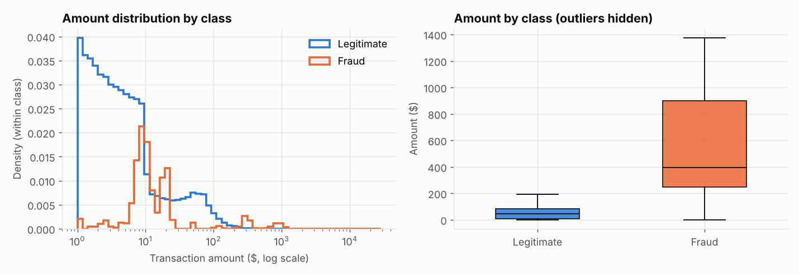
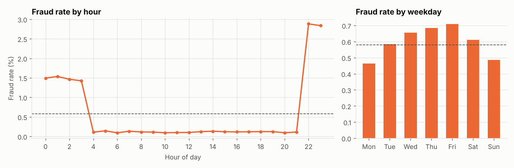
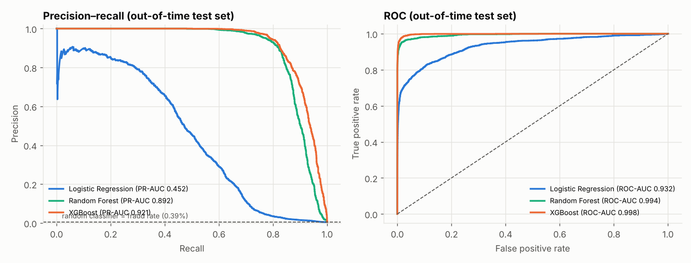
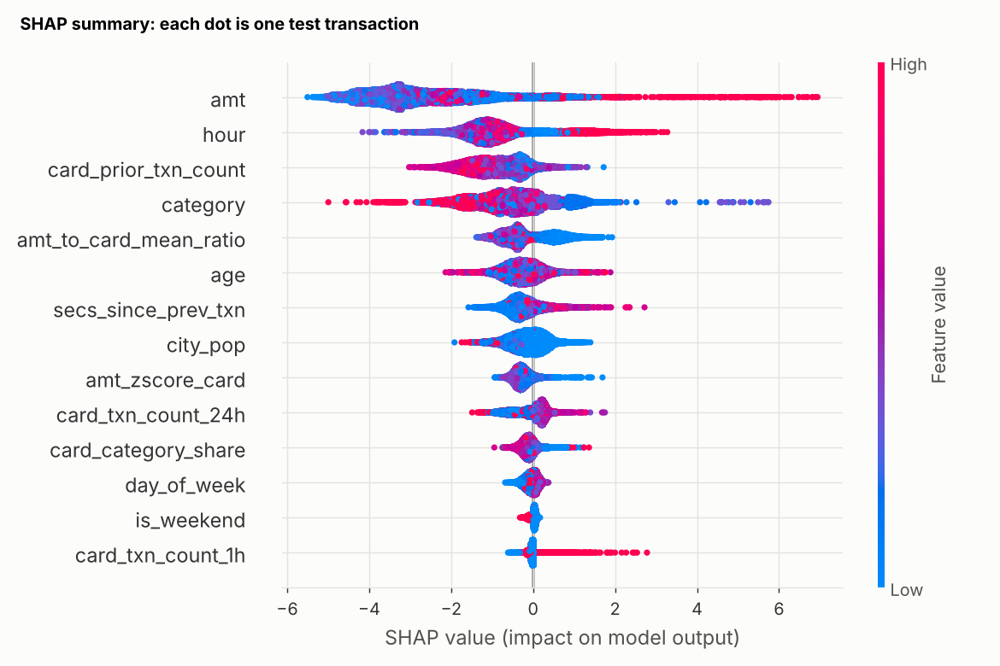
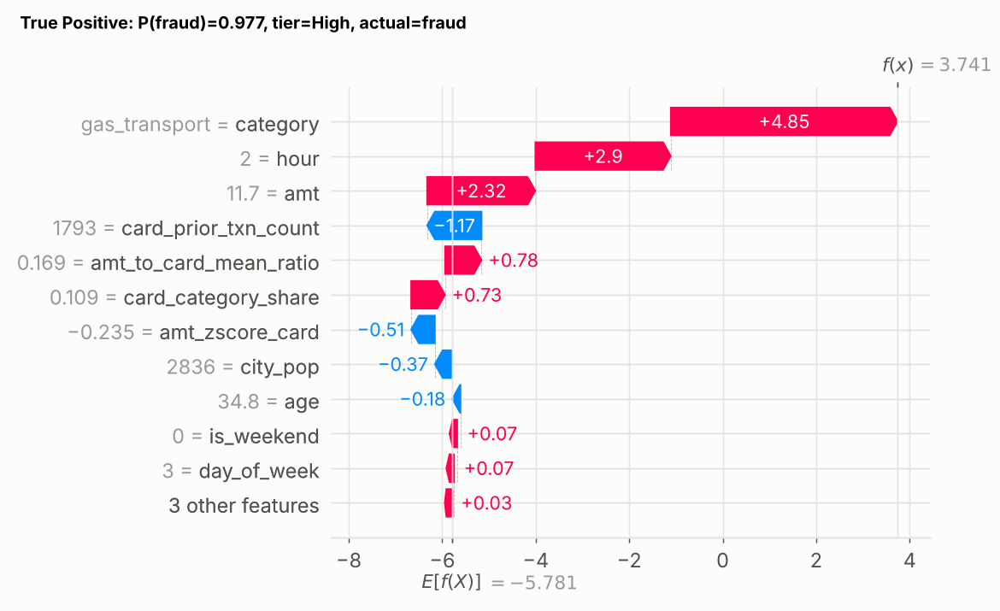

# Financial Transaction Fraud Detection & Risk Analytics

An end-to-end machine-learning system that scores credit-card transactions for fraud risk.
It covers data profiling, leakage analysis, behavioural feature engineering, imbalance-aware model
comparison, hyperparameter tuning, business-driven threshold selection, SHAP explanations, a
Low/Medium/High risk layer, SQL analytics (DuckDB) and a Streamlit dashboard.

> Every number in this README was produced by the code in this repository and can be regenerated
> (see [Reproduce](#reproduce)). Source files are referenced next to each result.

---

## 1. Problem statement
Given a card transaction and what the bank knows at that moment (the card's earlier transactions),
estimate the **probability that the transaction is fraudulent**, and turn it into an action:
approve, step-up authentication, or decline/hold.

## 2. Why fraud detection matters
Card fraud causes direct losses (chargebacks), operational cost (analyst reviews) and customer harm
(blocked legitimate payments). The core trade-off is **missed fraud (false negatives)** versus
**false alerts (false positives)**, so the system must be tuned to a business objective rather
than to accuracy.

## 3. Dataset
- Hugging Face: [`pointe77/credit-card-transaction`](https://huggingface.co/datasets/pointe77/credit-card-transaction), loaded with the `datasets` library.
- **Train:** 1,296,675 transactions (2019-01-01 → 2020-06-21). **Test:** 555,719 transactions (2020-06-21 → 2020-12-31).
- 24 columns: timestamp, card number, merchant, category, amount, cardholder profile, locations, `is_fraud`.
- The data is **synthetic** (simulated cardholders and merchants). See [`data/README.md`](data/README.md).

## 4. Data characteristics
(`reports/data_inspection.md`, `reports/data_inspection_notes.md`)
- Target `is_fraud`: **0.579%** fraud in train (≈172:1), **0.386%** in test (≈258:1).
- No duplicate rows; no train/test row overlap; the test period starts strictly after train ends,
  so the split is an honest **out-of-time** hold-out.
- Missing values only in `merch_zipcode` (15%), unrelated to fraud.
- `cc_num` identifies one customer (999 cards ↔ 999 profiles), making it the key for behavioural features.
- **Artefact:** 75 train cards and 16 test cards contain *only* fraud; every card first seen in the
  test period is 100% fraud. Controlled for with ablations (section 10).

## 5. EDA findings
(train split only, `reports/eda_summary.md`, `reports/figures/`)
| Question | Finding |
|---|---|
| Amounts? | Fraud median **$396.50** vs legitimate **$47.28**. Fraud is bimodal: ~$8–25 (card testing) and ~$250–1,100 |
| Category? | Highest: shopping_net **1.76%**, misc_net 1.45%, grocery_pos 1.41%. Lowest: health_fitness 0.16% |
| Time of day? | 22:00–23:00 ≈ **2.9%** and 00:00–03:00 ≈ 1.4–1.5% fraud rate, vs ≈0.1% during the day |
| Age? | Highest for 75+ (0.90%), lowest for 35–44 (0.43%) |
| Geography? | State rates are dominated by tiny samples (DE: 100% from 1 card with 9 txns) → state not used |
| Behaviour? | Fraud comes in **bursts**: median 10 frauds per card within ~45 hours (SQL) |

<p float="left">


</p>

## 6. Feature engineering
(`src/features.py`, rationale in `reports/data_leakage_analysis.md`)

**Removed:** row IDs, transaction ID, redundant `unix_time`, PII/identity proxies (names, street,
city, zip, job, home lat/long), `merchant` (693 values), `state` (tiny samples), merchant coordinates
(synthetic jitter, no signal), `gender` (excluded for fairness reasons), `dob` (→ `age`).

**Features used (14):**
| Feature | Why |
|---|---|
| `amt`, `category` | strongest raw signals |
| `hour`, `day_of_week`, `is_weekend` | fraud concentrates late at night |
| `age`, `city_pop` | customer context |
| `card_txn_count_1h`, `card_txn_count_24h`, `secs_since_prev_txn` | burst / velocity behaviour |
| `amt_to_card_mean_ratio`, `amt_zscore_card` | spend unusual *for this customer* |
| `card_category_share` | unfamiliar category for this customer |
| `card_prior_txn_count` | account history length (ablated because of the artefact) |

All card-history features use **only the card's earlier transactions** and **never past labels**,
verified against a brute-force recomputation.

## 7. Class imbalance
(`reports/imbalance_strategy_comparison.csv`)
A model predicting "legitimate" for everything would score 99.42% accuracy on train and 99.61% on test
while catching no fraud, so accuracy is not used for model selection. Strategies compared with
5-fold StratifiedGroupKFold (PR-AUC, mean ± std):

| Model | No weighting | Class weight / `scale_pos_weight` | SMOTE (train folds only) |
|---|---|---|---|
| Logistic Regression | **0.460 ± 0.021** | 0.253 ± 0.019 | 0.354 ± 0.012 |
| Random Forest | **0.869 ± 0.016** | 0.846 ± 0.019 | not run |
| XGBoost | 0.925 ± 0.010 | 0.928 ± 0.009 | 0.930 ± 0.010 |

Re-weighting/oversampling did **not** improve ranking quality. For XGBoost the differences are
within one standard deviation, so SMOTE's extra complexity is not justified. `scale_pos_weight` was
left to the hyperparameter search, which selected **1.0** (no re-weighting). Weighting mainly moves
predicted probabilities, which the threshold step handles explicitly.

## 8. Models tested and evaluation
**Validation design:** model comparison and tuning use **5-fold `StratifiedGroupKFold` grouped by
card** on a stratified 30% sample of train (389,003 rows, natural fraud rate). Grouping stops
transactions from the same customer and fraud burst landing in both training and validation folds.
Preprocessing (and SMOTE where used) is inside the pipeline, so it is fitted on training folds only.

**Cross-validation** (`reports/model_comparison.csv`, metrics at threshold 0.5 except the AUCs):
| Model | Precision | Recall | F1 | ROC-AUC | PR-AUC |
|---|---|---|---|---|---|
| Logistic Regression | 0.801 | 0.300 | 0.436 | 0.935 | 0.460 |
| Random Forest | 0.957 | 0.634 | 0.762 | 0.992 | 0.869 |
| XGBoost (SMOTE) | 0.946 | 0.810 | 0.872 | 0.998 | 0.930 |
| Random Forest (tuned) | 0.966 | 0.684 | 0.801 | 0.992 | 0.887 |
| **XGBoost (tuned)** | 0.958 | 0.793 | 0.868 | 0.998 | **0.931** |

**Out-of-time test set**, evaluated once after all choices were made (`reports/test_metrics.csv`):
| Model | Threshold | Precision | Recall | F1 | ROC-AUC | PR-AUC |
|---|---|---|---|---|---|---|
| Logistic Regression | 0.5 | 0.834 | 0.243 | 0.376 | 0.932 | 0.452 |
| Random Forest (tuned) | 0.5 | 0.973 | 0.720 | 0.828 | 0.994 | 0.892 |
| XGBoost (tuned) | 0.5 | 0.977 | 0.746 | 0.846 | 0.998 | 0.921 |
| **XGBoost (tuned)** | **0.012 (chosen)** | **0.545** | **0.930** | 0.688 | 0.998 | 0.921 |



ROC-AUC is ≥0.93 even for the weak baseline, while PR-AUC separates the models clearly (0.45 vs 0.92).
That is why PR-AUC is the primary metric.

## 9. Final model
**XGBoost**: best PR-AUC in grouped CV and on the test period. Tuned with `RandomizedSearchCV`
(20 candidates × 3 grouped folds, scored on PR-AUC): `n_estimators=756`, `learning_rate≈0.044`,
`max_depth=8`, `min_child_weight=2`, `subsample≈0.95`, `colsample_bytree≈0.69`, `gamma≈0.38`,
`reg_lambda≈0.39`, `scale_pos_weight=1`. Tuning gained only +0.001 PR-AUC over the best untuned
configuration (within noise); the defaults were already strong.

## 10. Threshold selection
(`reports/threshold_analysis.csv`, `reports/figures/threshold_tradeoff.png`)
- **Objective (fixed before seeing results):** maximise recall subject to **precision ≥ 50%**, i.e. at
  most one false alert per fraud caught.
- Chosen on **out-of-fold predictions over the full train set** (grouped 5-fold; OOF PR-AUC
  0.951 ± 0.010). The test set was not used.
- Result: threshold **0.0122** → on train OOF precision 50.0% / recall 96.6%; **on test precision 54.5% /
  recall 93.0%** (1,994 frauds caught, 151 missed, 1,662 false alerts out of 553,574 legitimate).
- For comparison, the default 0.5 on test gives 97.7% precision but only 74.6% recall (545 missed frauds).

**Robustness** (`reports/robustness_checks.csv`): test PR-AUC 0.921 (all cards) → 0.912 excluding
the 163 transactions on never-seen cards → 0.917 when `card_prior_txn_count` is removed. The headline
result does not depend materially on the new-card artefact.

## 11. Risk scoring
(`src/risk.py`, `reports/risk_tier_summary.csv`; boundaries derived from OOF train predictions, configurable)
| Tier | Rule | Action | Test: share of txns | Fraud rate in tier | Share of all fraud |
|---|---|---|---|---|---|
| Low | p < 0.0122 | approve | 99.34% | 0.03% | 7.0% |
| Medium | 0.0122 ≤ p < 0.1923 (alert threshold; precision ≥ 50% overall) | step-up auth / review | 0.32% | 14.0% | 11.7% |
| High | p ≥ 0.1923 (validation precision ≥ 90%) | decline / hold | 0.34% | 93.2% | 81.3% |

*Transparency note:* the first tier design ("Medium = threshold reaching 95% recall") produced a
boundary above the alert threshold, so it was replaced by the 90%-precision rule after seeing the
precision–recall curve. The alert threshold itself was pre-registered.

## 12. SHAP explainability
(`src/explainability.py`, `reports/figures/shap/`)
- Global mean |SHAP| ranking: `amt` > `hour` > `card_prior_txn_count` > `category` >
  `amt_to_card_mean_ratio` > `age` > …
- Gain importance tells a different story: `card_txn_count_1h` has 22.6% of total gain but the lowest
  mean |SHAP|, because it is decisive for the few transactions inside a burst and zero for nearly all others.
- Example (caught fraud, P=0.977): `category=gas_transport` (+4.85 log-odds), `hour=2` (+2.90),
  `amt=$11.70` (+2.32), a pattern consistent with small "card-testing" transactions at night.
- SHAP values describe how the model uses features; **they are not causal explanations**.

<p float="left">


</p>

## 13. SQL analysis
`sql/fraud_analysis.sql` holds 16 DuckDB queries, run by `python -m src.run_sql` and saved to `reports/sql/`.
They cover fraud rate by category and amount band, amount by fraud status, top categories (`HAVING`,
`RANK()`), daily volume with a 7-day rolling window, monthly trends, hour and weekday patterns,
card-level aggregation, fraud-burst duration, and a `LAG()` time-since-previous-transaction comparison
(median 82 min before a fraud vs 262 min before a legitimate transaction). The dashboard's analytics
page reads these outputs directly.

## 14. Streamlit application
`streamlit run app/streamlit_app.py` opens four pages:
1. **Overview**: volume, fraud rate, amounts, headline test metrics.
2. **Fraud analytics**: category, amount, hour, weekday, monthly and state views.
3. **Risk predictor**: enter a transaction and card-history summary (or load one of 160 real
   test transactions) to get a probability, risk tier, recommended action and a SHAP waterfall.
   Features are built by the same function used in training (verified: max score difference 3×10⁻⁸).
4. **Model performance**: test metrics, confusion matrix, PR/ROC curves, CV table, threshold
   analysis, risk tiers, robustness checks, global SHAP.

## 15. Limitations
- **Synthetic data**: patterns such as night-time fraud and fraud-only new cards come from a simulator.
- **Only 999 customers**: customer attributes (age, city population) can partly identify cards.
- **Drift**: the fraud rate falls from 0.58% to 0.39% between periods. PR-AUC drops from 0.951 (train OOF)
  to 0.921 (test), partly because precision is harder to achieve at a lower base rate.
- **Probabilities are not calibrated** for expected-loss use; the threshold was set empirically.
- The Medium tier mixes friction and review; real costs per action were not available.
- Fairness: gender is excluded, but age remains a feature and would need a formal fairness review.

## 16. Future improvements
- Explicit cost-based thresholding (fraud amount vs review cost) and per-segment thresholds.
- Probability calibration (isotonic) and monitoring for drift (PSI) with scheduled retraining.
- Out-of-fold target-encoded merchant risk; graph features (shared merchants/devices).
- Time-based rolling-origin validation in addition to grouped CV.
- Real-time feature store + model service; champion/challenger evaluation.

---

## Reproduce

**Quick start (dashboard only):** the trained XGBoost pipeline (`models/xgb_pipeline.joblib`, ~3 MB) and
its thresholds (`models/metadata.json`) are committed, along with the small report/SQL outputs the app
reads, so the dashboard runs straight after cloning:
```bash
pip install -r requirements.txt
streamlit run app/streamlit_app.py
```
`scikit-learn` and `xgboost` are pinned exactly in `requirements.txt` because a pickled model is only
guaranteed to load with the library versions it was saved with. If you change those versions, retrain
with `python -m src.train`. Only load `.joblib` files from sources you trust: unpickling can execute code.

**Full pipeline (from raw data):**
```bash
python -m venv .venv && source .venv/bin/activate      # Python 3.11+
pip install -r requirements.txt

python -m src.inspect_data     # downloads data from Hugging Face, writes reports/data_inspection.md
python -m src.features         # builds data/processed/features.parquet
python -m src.eda              # EDA figures + reports/eda_summary.md
python -m src.run_sql          # SQL analytics -> reports/sql/
python -m src.train            # compare, tune, threshold, final test evaluation (~35 min on 4 CPU cores)
python -m src.risk             # risk-tier summary on the test set
python -m src.explainability   # SHAP figures
python -m src.dashboard_data   # sample transactions for the app
python notebooks/build_notebooks.py   # re-execute the walkthrough notebooks

streamlit run app/streamlit_app.py
```
`python -m src.train --stage compare|tune|final` runs a single stage. Runtime knobs (env vars):
`CV_SAMPLE_FRACTION` (default 0.3), `TUNING_ITERATIONS` (20), `RF_TUNING_ITERATIONS` (6), `N_JOBS` (-1).
Risk-tier overrides: `RISK_MEDIUM_THRESHOLD`, `RISK_HIGH_THRESHOLD`. All seeds are fixed (`RANDOM_SEED=42`).

## Project structure
```
data/README.md                 dataset + download instructions (raw data git-ignored)
models/                        committed: xgb_pipeline.joblib + metadata.json (others regenerated)
notebooks/01-05_*.ipynb        executed walkthroughs (built by notebooks/build_notebooks.py)
src/config.py                  paths, feature lists, CV/threshold/risk settings
src/data_loader.py             Hugging Face loading + Parquet cache
src/inspect_data.py            stage-0 inspection report
src/eda.py                     EDA figures (train only)
src/features.py                transaction + leak-free card-history features
src/preprocessing.py           ColumnTransformer pipelines (linear vs tree)
src/train.py                   CV comparison, imbalance strategies, tuning, threshold, final eval
src/evaluate.py                metrics, threshold utilities, evaluation plots
src/risk.py                    Low / Medium / High risk layer
src/explainability.py          SHAP global + local explanations
src/run_sql.py, sql/           DuckDB analytics
src/dashboard_data.py          small artefacts for the app
app/streamlit_app.py           dashboard
reports/                       all generated tables, figures and write-ups
INTERVIEW_NOTES.md             explanations of every decision
```
